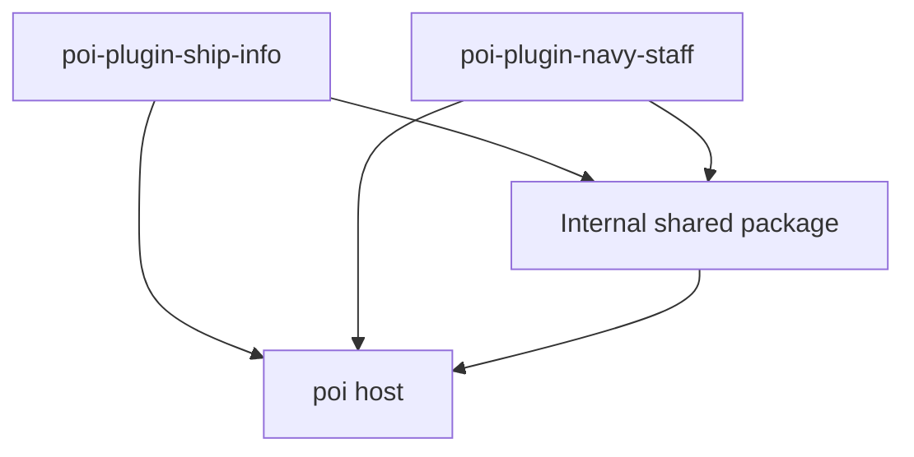

# Ship Info / Navy Staff split design

Status: design draft. Code has not been split. This document distinguishes confirmed requirements from proposals and unresolved decisions.

## 1. Goals and scope

Confirmed requirements:

- Keep the ship information table in `poi-plugin-ship-info`.
- Extract the built-in sortie planner into `poi-plugin-navy-staff`.
- Maintain both plugins in one monorepo and reuse code needed by both.
- Complete the design before moving code, refactoring, or publishing.

The proposed first release preserves existing functionality. Ship Info retains filtering, sorting, column configuration, and CSV export. Navy Staff receives the area and ship grid views, ship selection and assignment, synchronization with actual sortie tags, and image export. Its main screen should expose the planner directly; the old sidebar button and modal shell need not move with it.

Multiple plans, cross-event archives, automatic fleet composition, and new planning rules are outside the first split.

## 2. Existing coupling

| Location | Current responsibility | Required separation |
| --- | --- | --- |
| `views/sidebar/planner/` | Planner UI and interactions | Move to Navy Staff and make it the main interface |
| `views/sidebar/index.tsx` | Sidebar controls and `initStore` call | Remove the planner entry while retaining Ship Info initialization |
| `views/redux.ts` | `bookmark`, `planner`, `ready`, `ui`, and file persistence | Separate reducers, actions, and persistence by ownership |
| `views/selectors.ts` | Table filtering, ship display data, fleet membership, and planner queries | Split by actual consumers instead of sharing the entire file |
| `views/utils.ts` | Statistics, classification, names, screenshots, and other utilities | Separate responsibilities and side effects |
| `views/components/fleet-icon.tsx`, `views/styles.ts`, and some sidebar controls | Presentation used by both interfaces | Candidates for shared modules |
| `i18n/` | Both features use the Ship Info namespace | Supply each plugin with its own required translations |

Two details need particular attention:

1. The existing JSON file contains both table and planner state. Saving the remaining state after removing the `planner` reducer could erase old plans before Navy Staff imports them.
2. The `dataObserver` subscription currently lives in the Planner component's mounting logic. Removing that interface requires an explicit persistence lifecycle for Ship Info itself.

## 3. Proposed monorepo structure

```text
plugin-ship-info/
├── AGENTS.md
├── docs/
│   └── plugin-split-design.md
├── package.json                 # Private workspace root and development commands
├── pnpm-lock.yaml               # One repository lockfile
├── pnpm-workspace.yaml          # Workspace configuration
├── packages/
│   ├── ship-info/               # Published as poi-plugin-ship-info
│   │   ├── package.json
│   │   ├── src/
│   │   └── i18n/
│   ├── navy-staff/              # Published as poi-plugin-navy-staff
│   │   ├── package.json
│   │   ├── src/
│   │   └── i18n/
│   └── shared/                  # Private internal package
│       ├── package.json
│       └── src/
└── .github/workflows/           # Align with main-branch CI at implementation time
```

Use pnpm workspaces to manage the three packages and retain tsdown for builds. Keep common TypeScript and build configuration at the root, with plugin-specific entries and necessary differences in each plugin. No additional monorepo orchestration framework is needed initially.

These directories and internal package names are proposals. The repository currently contains one plugin at its root. Organize each `src/` around clear ownership with minimal unnecessary movement.

## 4. Shared code responsibilities

Dependency direction:



Neither plugin imports the other or requires the other to be installed. The shared package does not depend on either plugin.

Start with modules inside one shared package:

- **Common ship logic:** classification, name handling, fleet membership, and other functions actually used by both plugins. Reuse existing kcsapi types without inventing a universal ship model.
- **poi integration:** shared read-only selectors and host type declarations. Keep pure calculations independent of `window`, Electron, and the global store.
- **Presentation:** fleet icons, theme surface helpers, and controls used by both interfaces. Pass content through parameters rather than reading plugin-specific configuration or plans.

Keep these responsibilities in their respective plugins:

| Ship Info | Navy Staff |
| --- | --- |
| Table row data, columns, filtering, and sorting | Planned ship assignments and area mappings |
| Filter presets, column configuration, and CSV fields | Adding, removing, moving ships, and synchronizing sortie tags |
| Table-specific statistics | Planner search, display data, and screenshot export |

For example, `IShipRawData` contains table display options and belongs in Ship Info. `IShipInfoMenuData`, currently used only by the planner, belongs in Navy Staff. Ship-related fields alone do not make a type shared. `captureRect` is currently used for planner screenshots and can remain in Navy Staff for the first split.

Expose shared modules by purpose, such as `shared/ships`, `shared/poi`, and `shared/ui`. Importing basic ship logic must not register observers, perform file operations, or load screenshot libraries. Extract only implementations both plugins actually need.

## 5. State, configuration, and lifecycle

Both plugins continue to use poi's runtime and Redux store, registering separate extension state. Sharing the host store does not imply sharing plugin state.

| Concern | Ship Info | Navy Staff (proposed) |
| --- | --- | --- |
| npm package and plugin ID | `poi-plugin-ship-info` | `poi-plugin-navy-staff` |
| Redux extension state and action prefix | Retain existing identity | Use the new plugin identity |
| Configuration | Retain existing table paths | Separate `plugin.NavyStaff.*` paths |
| JSON file | `poi-plugin-ship-info.json` | `poi-plugin-navy-staff.json` |
| Translation namespace | `poi-plugin-ship-info` | `poi-plugin-navy-staff` |

Each plugin owns initialization, readiness, persistence subscriptions, and cleanup. Persistence must not depend on the other plugin's interface being open. Defaults must not overwrite saved data before loading finishes. Verify lifecycle placement against poi's main window, standalone windows, and plugin unloading to avoid duplicate subscriptions and writes.

Move planner options such as `displayFleetName` to Navy Staff. Preserve Ship Info's filter and column configuration paths so the split does not reset preferences.

## 6. Legacy plan migration

Propose a one-time import into the new file, after which each plugin saves its own data:

1. If Navy Staff's data file exists, use it as authoritative. An existing empty plan must not trigger another import.
2. Only if the new file is absent, read `planner` from `APPDATA_PATH/poi-plugin-ship-info.json`. Preserve `current` and `archive`; exclude table bookmarks and transient UI state.
3. Once the new file is successfully written, use it for subsequent loads and saves. Navy Staff must not modify or delete the legacy file.
4. If the legacy file is absent, initialize an empty plan. Corrupt data, invalid format, and read or write failures must preserve the original data and surface an error, rather than being treated as absence.
5. During a transition period, Ship Info preserves the legacy `planner` value when saving its original file, without continuing to maintain planner behavior. This supports users who upgrade Ship Info before installing Navy Staff. Decide removal of the legacy field separately.
6. Import planner display options only when the corresponding new configuration is unset; do not overwrite preferences already changed in Navy Staff.

Migration and event changes are separate concerns. Do not truncate imported arrays because the current event has a different area count. Confirm sortie tag synchronization, event transitions, and obsolete assignment handling before implementation. The first split does not introduce a new event archive system.

## 7. Build, translations, and publishing

- Mark the root and shared package as `private`. Publish only the two plugins to npm, allowing their versions to change independently.
- Bundle shared implementations into each plugin. Published packages must not retain runtime references to local workspaces, sibling directories, or unpublished internal packages.
- Preserve host external dependencies, including React, React Redux, styled-components, and Blueprint. Shared code must not introduce a second copy of the host UI runtime.
- Each plugin needs its own `package.json`, valid compiled entry, poi metadata, translations, and assets. Verify actual packed artifacts, not just workspace execution.
- Translation source text may be reused, but each built plugin's `i18n/` must be self-contained. Shared presentation modules receive translated text or a translation function instead of hard-coding the Ship Info namespace.
- CI checks both plugins and the shared package, then builds and packs each plugin. Shared changes require validation of both plugins; running all checks initially is sufficient.
- Schedule publishing and installation guidance separately. Documentation and initial code movement do not automatically publish npm packages.

## 8. Proposed implementation sequence and acceptance

Proceed in three reviewable steps:

1. **Establish workspaces:** move the existing Ship Info structure and update development commands while preserving functionality and packaging.
2. **Extract shared code and Navy Staff:** move planner UI and state, establish independent initialization and persistence, import legacy data, and remove the planner entry from Ship Info.
3. **Verify independent installation and artifacts:** update CI, documentation, and release procedures, and inspect both actual installation packages.

Acceptance should cover:

- Ship Info alone, Navy Staff alone, and both installed together load successfully. Translations and assets work without the other plugin.
- Table filtering, sorting, column configuration, and export still work. Planner addition, removal, movement, both views, and screenshots still work.
- Migration handles legacy plans, an existing empty new plan, missing files, corrupt data, write failures, and upgrading Ship Info before installing Navy Staff.
- Data survives reopening plugins and restarting poi, without initialization overwrites, writes to the other plugin's file, or duplicate subscriptions.
- Full type checking, builds, and packing pass. Actual packages contain valid entries, required resources, and bundled internal dependencies.

## 9. Open decisions before implementation

- Navy Staff's display name, including its Chinese translation, icon, and standalone layout.
- Whether the first split preserves all current synchronization rules, and how event transitions display and retain old assignments.
- Whether legacy import needs a visible notification, and how long Ship Info retains the old `planner` field.
- Package version strategy, release order, and how existing users learn that planning has moved to a separate plugin.

These decisions do not prevent further design work, but proposed product behavior remains subject to agreement before implementation.
