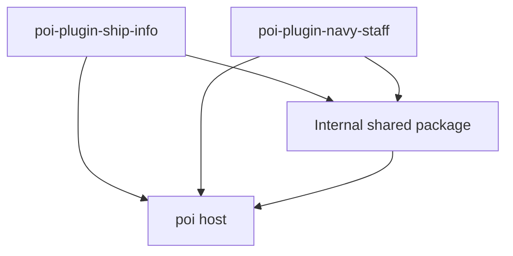

# Ship Info / Navy Staff split design

Status: implemented in four stacked changes, with local acceptance checks complete. Ship Info and Navy Staff are independent plugin packages in one pnpm workspace. This document records ownership, migration behavior, implementation evidence, and release boundaries. Neither package has been published as part of this work.

## 1. Goals and scope

Confirmed requirements:

- Keep the ship information table in `poi-plugin-ship-info`.
- Extract the built-in sortie planner into `poi-plugin-navy-staff`.
- Maintain both plugins in one monorepo and reuse code needed by both.
- Implement the agreed design in reviewable changes, with behavior tests and documentation kept in sync. Publishing is a separate operation.

The proposed first release preserves existing functionality. Ship Info retains filtering, sorting, column configuration, and CSV export. Navy Staff receives the area and ship grid views, ship selection and assignment, synchronization with actual sortie tags, and image export. Its main screen exposes the planner directly. Ship Info retains the former Deck Planner entry, which opens a migration notice with the new plugin name and installation instructions in poi.

Multiple plans, cross-event archives, automatic fleet composition, and new planning rules are outside the first split.

The follow-up [Navy Staff workspaces design](navy-staff-workspaces-design.md) proposes multiple plans, history, captured area information, and read-only reference sharing. Those enhancements are not part of the completed split described here.

## 2. Ownership after extraction

Ship Info source paths below are relative to `packages/ship-info/src/` unless another package is named. The shared workspace contains the modules previously extracted at root `shared/`.

| Location | Responsibility | Boundary |
| --- | --- | --- |
| `packages/navy-staff/src/views/` | Planner UI, reducer/actions, menu selectors, migration, and screenshot capture | Independent plugin main interface; no table sidebar or planner modal |
| `views/sidebar/index.tsx` | Table sidebar controls and planner migration notice | The former planner entry opens instructions only; initialization is plugin-owned |
| `views/redux.ts` | `bookmark`, load status, and `ui` | No planner reducer; I/O lives in `views/persistence.ts` |
| `views/selectors.ts` and `views/utils.ts` | Validated table configuration, row data, and display calculations | Retain in Ship Info; the active filtering and sorting implementation lives in `views/table/` |
| `packages/shared/src/` | Classification, fleet membership, UI, serialized writes, and persistence lifecycle | Private workspace; callers own identity, data validation, and migration |
| `packages/*/i18n/` | Self-contained plugin translations | Each plugin uses its own namespace |

Two details need particular attention:

1. The existing JSON file contains both table and planner state. Saving the remaining state after removing the `planner` reducer could erase old plans before Navy Staff imports them.
2. The first layer replaces Planner's `dataObserver` mounting logic with plugin-owned loading and saving in `views/lifecycle.ts` and `views/persistence.ts`. Removing the planner interface no longer removes Ship Info persistence.

## 3. Monorepo structure

```text
plugin-ship-info/
├── AGENTS.md
├── build/plugin.config.ts       # Common plugin build and host externals
├── docs/
│   └── plugin-split-design.md
├── package.json                 # Private workspace root and development commands
├── pnpm-lock.yaml               # One repository lockfile
├── pnpm-workspace.yaml          # Workspace configuration
├── packages/
│   ├── ship-info/               # Published as poi-plugin-ship-info
│   │   ├── package.json
│   │   ├── src/
│   │   └── i18n/
│   ├── navy-staff/              # Published as poi-plugin-navy-staff
│   │   ├── package.json
│   │   ├── src/
│   │   └── i18n/
│   └── shared/                  # Private internal package
│       ├── package.json
│       └── src/
└── .github/workflows/           # Align with main-branch CI at implementation time
```

Use pnpm workspaces to manage the three packages and build libraries with `vp pack` (Vite+). Common TypeScript and build configuration live at the root. Each plugin's `vite.config.ts` re-exports `build/plugin.config.ts`; package-local build commands resolve the entry and output paths from that package. No additional monorepo orchestration framework is needed.

The workspace layer relocates Ship Info and shared code first; Navy Staff is added by the final extraction. The internal package is named `@poi-plugins/ship-info-shared`. It is a private, source-only build dependency with purpose-specific exports, bundled into each consumer. Tests, stories, preview adapters, host declarations, and development tooling stay at the repository root.

## 4. Shared code responsibilities

Dependency direction:



Neither plugin imports the other or requires the other to be installed. The shared package does not depend on either plugin.

Start with modules inside one shared package:

- **Common ship logic:** classification, name handling, fleet membership, and other functions actually used by both plugins. Reuse existing kcsapi types without inventing a universal ship model.
- **poi integration:** shared read-only selectors and host type declarations. Keep pure calculations independent of `window`, Electron, and the global store.
- **Presentation:** fleet icons, theme surface helpers, and controls used by both interfaces. Pass content through parameters rather than reading plugin-specific configuration or plans.
- **Persistence lifecycle:** serialized writes, subscriptions, load status, and cancellation of superseded loads. Each plugin supplies its own file path, actions, selector, validation, and loader. Legacy import remains in Navy Staff; opaque legacy preservation remains in Ship Info.

Keep these responsibilities in their respective plugins:

| Ship Info | Navy Staff |
| --- | --- |
| Table row data, columns, filtering, and sorting | Planned ship assignments and area mappings |
| Filter presets, column configuration, and CSV fields | Adding, removing, moving ships, and synchronizing sortie tags |
| Table-specific statistics | Planner search, display data, and screenshot export |

For example, `IShipRawData` contains table display options and belongs in Ship Info. `IShipInfoMenuData`, currently used only by the planner, belongs in Navy Staff. Ship-related fields alone do not make a type shared. `captureRect` is currently used for planner screenshots and can remain in Navy Staff for the first split.

Expose shared modules by purpose, including `ship-types`, `fleet`, `ui/*`, `file-writer`, and `persistence`. Importing basic ship logic must not register observers, perform file operations, or load screenshot libraries. Extract only implementations both plugins actually need.

## 5. State, configuration, and lifecycle

Both plugins continue to use poi's runtime and Redux store, registering separate extension state. Sharing the host store does not imply sharing plugin state.

| Concern | Ship Info | Navy Staff |
| --- | --- | --- |
| npm package and plugin ID | `poi-plugin-ship-info` | `poi-plugin-navy-staff` |
| Redux extension state and action prefix | Retain existing identity | Use the new plugin identity |
| Configuration | Retain existing table paths | Separate `plugin.NavyStaff.*` paths |
| JSON file | `poi-plugin-ship-info.json` | `poi-plugin-navy-staff.json` |
| Translation namespace | `poi-plugin-ship-info` | `poi-plugin-navy-staff` |

Each plugin owns initialization, readiness, persistence subscriptions, and cleanup. Persistence must not depend on the other plugin's interface being open. Defaults must not overwrite saved data before loading finishes. Verify lifecycle placement against poi's main window, standalone windows, and plugin unloading to avoid duplicate subscriptions and writes.

The host registers the extension reducer before `pluginDidLoad` and calls `pluginWillUnload` before removing it. Its `windowMode` UI uses a React portal in the existing renderer and shares the same store. Therefore each loaded plugin owns one persistence subscription, independent of mounted views; no additional window synchronization layer is needed. Unloading invalidates pending initialization and unsubscribes. Missing files allow empty initialization; malformed data and other read failures must surface an error and leave saving disabled. Serialized writes must recover after rejection without unhandled promises or timer polling.

poi clears the plugin's module cache on unload. Write coordination must therefore survive module replacement within the host renderer: a fresh lifecycle waits for the previous queued saves before reading. A module-local writer alone cannot guarantee this. Tests must exercise a fresh module load, not only stop/start on the same persistence instance. The host also disables language fallback, so failure notifications must remain readable without an English fallback locale.

Move planner options such as `displayFleetName` to Navy Staff. Preserve Ship Info's filter and column configuration paths so the split does not reset preferences.

## 6. Legacy plan migration

Use a one-time import into the new file, after which each plugin saves its own data:

1. If Navy Staff's data file exists, use it as authoritative. An existing empty plan must not trigger another import.
2. Only if the new file is absent, read `planner` from `APPDATA_PATH/poi-plugin-ship-info.json`. Preserve `current` and `archive`; exclude table bookmarks and transient UI state.
3. Once the new file is successfully written, use it for subsequent loads and saves. Navy Staff must not modify or delete the legacy file.
4. If the legacy file is absent, initialize an empty plan. Corrupt data, invalid format, and read or write failures must preserve the original data and surface an error, rather than being treated as absence.
5. During a transition period, Ship Info preserves the legacy `planner` value when saving its original file, without continuing to maintain planner behavior. This supports users who upgrade Ship Info before installing Navy Staff. Decide removal of the legacy field separately.
6. Import `plugin.ShipInfo.displayFleetName` only when `plugin.NavyStaff.displayFleetName` is unset; preserve explicit false and true. Recheck the unset option on successful loads, so unloading after the initial file write cannot permanently skip configuration import.

### File format versions

Both plugin files now have a top-level integer `version`. Each plugin owns its
format version and migration steps independently; this number is unrelated to
its npm package version.

- Files without `version` use format v0. The initial migration, v0 → v1, adds
  `"version": 1` without changing the data layout.
- Loading an older supported format applies migrations in order, validates the
  resulting data, and saves the upgraded file before enabling normal editing.
  A v1 file needs no migration write. Subsequent saves include the current
  format version; the version is file metadata, not Redux state.
- Ship Info preserves its opaque legacy `planner` field, including explicit
  `null`, while upgrading its own file. Navy Staff imports planner data from
  either unversioned or v1 Ship Info files only when its own file is absent,
  and writes a v1 Navy file without modifying the source.
- Unknown future versions and invalid version values are load errors. Do not
  guess their layout or overwrite them. A newer Ship Info source format is
  likewise not silently imported by an older Navy Staff implementation.
- Add a migration step when a plugin's persisted layout changes. Steps transform
  one version into the next; shared code only runs the ordered steps and checks
  the version boundary.

File absence is the only special initialization case. Other read, parse, and
write failures retain the existing error behavior. There is no corrupt-file
reset, backup, automatic recovery, or additional notification policy. Failed or
superseded format migrations must not enable editing or overwrite a newer load.

Migration and event changes are separate concerns. Do not truncate imported arrays because the current event has a different area count. Confirm sortie tag synchronization, event transitions, and obsolete assignment handling before implementation. The first split does not introduce a new event archive system.

## 7. Build, translations, and publishing

- Mark the root and shared package as `private`. Publish only the two plugins to npm, allowing their versions to change independently.
- Bundle shared implementations into each plugin. Published packages must not retain runtime references to local workspaces, sibling directories, or unpublished internal packages.
- Preserve host external dependencies, including React, React Redux, styled-components, and Blueprint. Shared code must not introduce a second copy of the host UI runtime.
- Each plugin needs its own `package.json`, valid compiled entry, poi metadata, translations, and assets. Verify actual packed artifacts, not just workspace execution.
- Translation source text may be reused, but each built plugin's `i18n/` must be self-contained. Shared presentation modules receive translated text or a translation function instead of hard-coding the Ship Info namespace.
- CI checks both plugins and the shared package, then builds and packs each plugin. Shared changes require validation of both plugins; running all checks initially is sufficient.
- Schedule publishing and installation guidance separately. Documentation and initial code movement do not automatically publish npm packages.
- `poi-plugin-navy-staff` already exists on npm as a placeholder. The extracted planner requires a subsequent release under that existing package name, coordinated with adding Navy Staff to poi's plugin list. Users find **Navy Staff** in **Settings → Plugins** and click **Install**. Manual installation through **Install directly from npm** uses `poi-plugin-navy-staff` and also requires the planner release to be available.

## 8. Implementation sequence and acceptance

Proceed in four stacked PRs. Keep each layer independently reviewable and preserve behavior until the final extraction:

1. **Separate lifecycle and persistence:** remove initialization and save subscriptions from UI mounts, protect failed reads from overwrite, recover failed writes, and test lifecycle ownership and unload races. Status: implemented and locally verified (88 Node/jsdom tests, 89 Chromium scenarios, type check, plugin build, and static Storybook build). The tests model poi's extension state and module-cache clearing; a live poi installation has not been exercised.
2. **Separate ownership:** isolate planner state, selectors, display types, and screenshot helpers from table code; extract shared modules only where both features actually consume them. Preserve the existing single-plugin interface. Status: implemented in `views/planner/` and root `shared/`, locally verified with 90 Node/jsdom tests, 89 Chromium scenarios, type checking, both builds, and local Codex Sol review. Shared imports have dependency-direction guards; all 22 ship-type labels match the prior behavior across five locales.
3. **Establish workspaces:** move Ship Info and shared modules into pnpm packages, update builds, tests, preview paths, and CI, and verify the existing published artifact remains self-contained. Status: implemented and locally verified with frozen installation, 90 Node/jsdom tests, 89 Chromium scenarios, type checking, builds, packing, and artifact verification. Local Codex Sol review confirmed unchanged dependency versions and host externals; its README omission finding was fixed and the package reverified. Root `pnpm run pack` and `pnpm run verify:package` validate the compiled entry, manifest, README, all five locales, and all four assets. Shared code is bundled and absent from runtime manifest dependencies. No live poi installation was exercised.
4. **Extract Navy Staff:** give the planner its own plugin entry, state, configuration, translations, and persistence; implement legacy import and retain legacy data in Ship Info; replace the old planner content with a migration notice. Status: implemented. Frozen installation, type checking, 108 Node/jsdom tests, and 97 Chromium scenarios pass. Tests cover the original Ship Info entry opening a localized migration notice, independent and combined interfaces, Navy-only translations without language fallback, detached-window configuration, smaller/empty maps, an unloaded roster, migration failures, stale reads, and fresh-module reloads with pending writes. Both packed entries execute against a controlled host with real React/styled-components, actual exported reducers/lifecycle hooks, and temporary files, independently and together. Manifest metadata, all packaged resources, and absence of runtime workspace/sibling dependencies are checked. The artifact smoke exposed and fixed a CommonJS default-import mismatch caused by the private shared package's unnecessary ESM marker; shared code remains bundled into each plugin.

Each layer requires relevant behavior tests, type checking, and a build, plus a local Codex Sol review before submission. Browser tests cover affected user workflows; packaging changes require actual artifact inspection. Reviews stay local rather than posting unsolicited GitHub review comments. Passing tests with host adapters must not be described as a live poi installation test.

Acceptance should cover:

- Ship Info alone, Navy Staff alone, and both installed together load successfully. Translations and assets work without the other plugin.
- Table filtering, sorting, column configuration, and export still work. Planner addition, removal, movement, both views, and screenshots still work.
- Migration handles legacy plans, an existing empty new plan, missing files, corrupt data, write failures, and upgrading Ship Info before installing Navy Staff.
- Data survives reopening plugins and restarting poi, without initialization overwrites, writes to the other plugin's file, or duplicate subscriptions.
- Full type checking, builds, and packing pass. Actual packages contain valid entries, required resources, and bundled internal dependencies.

## 9. Initial defaults and release decisions

- Use Navy Staff as the plugin title key, localized as `作戦参謀` (ja-JP), `작전참모` (ko-KR), `作战参谋` (zh-CN), and `作戰參謀` (zh-TW). Ship Info's migration notice uses the same localized display names. Keep the package ID `poi-plugin-navy-staff`. Reuse the existing planner visual conventions and show the planner directly in its main view.
- Keep a migration notice in Ship Info's original Deck Planner area. It directs users to find Navy Staff in poi's plugin list and click **Install**, and shows the full package name `poi-plugin-navy-staff` alongside the manual installation instructions. It does not retain planner logic or depend on Navy Staff being installed.
- Preserve existing assignment and synchronization workflows. Retain assignments beyond the current event's area count; event changes must not silently destroy imported data. A new event archive system remains out of scope.
- Surface import/load failures. Retain the legacy `planner` field in Ship Info until its removal is separately agreed; Navy Staff never deletes it.
- Ship Info's workspace manifest retains version `8.1.1`. Navy Staff's manifest now uses the existing npm placeholder version `1.2.0` as its release baseline, replacing the provisional development value `0.1.0`. Initial major changesets prepare Ship Info `9.0.0` and Navy Staff `2.0.0`; neither is published by the release-automation setup. See [releases.md](releases.md) for independent release preparation and publication.
- Document separate installation and migration. Package publication, release timing, and any release version changes require a separate release operation; this implementation creates reviewable PRs only.

The final plugin builds, static Storybook build, packed artifact checks, and local Codex Sol review also passed. Validation uses browser and host adapters, plus real files for artifact and writer checks. It does not include installing the plugins into a live poi/Electron session, restarting that application, or validating rendered screenshot pixels. Those remain release checks.
